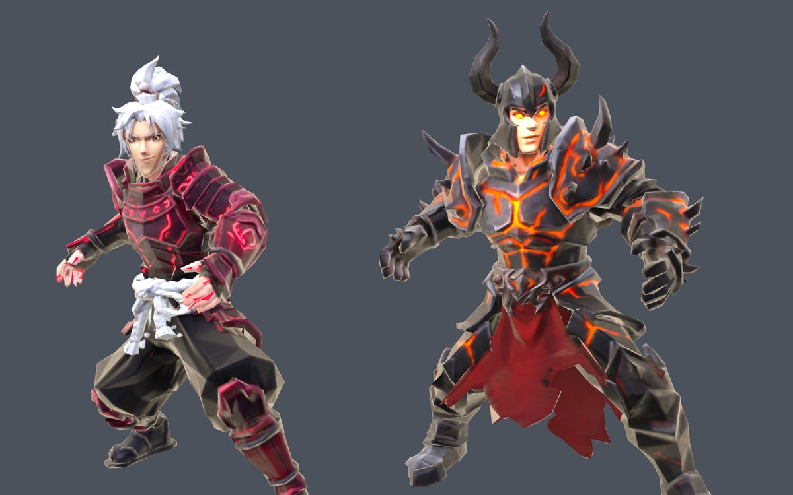

# Game-ready (AssetFurnace add-on)

Takes what AssetFurnace makes the last step into a game: a rigged figure or a finished prop goes in, a file an engine
takes as it is comes out.

## Make a figure game-ready

Give it the GLB from Rig (or Animate). It writes one GLB with:

- **one material and one atlas** (512 to 2048 px), where no texel is painted twice, the colour baked from the
  figure's own textures, the normal map's detail kept as soft light from above, so no normal map is needed;
- **the triangle count you pick** (8,000 to 30,000, or as rigged), with the **hidden inner wall dropped** first:
  Pixal3D leaves a second surface inside a figure that nobody sees, and dropping it gives the budget to what is
  seen. The drop is **checked in motion**: the figure is posed in a run, a dodge, a fall and a reach and seen from
  twelve sides, and any dropped face that would show as a hole is put back;
- **real height** with the feet on the floor; a **sole the generator made up** below the pictures' feet (it finds
  the Finish run in the rig's licence record) is cut off, and thin plates of it the cut leaves in front of the toe
  are cleared and the toe closed (a heel only a little too high is pressed flat instead);
- **engine bone names** (Unity's Humanoid or Mixamo, or the rig's own), finger bones kept or folded into the hands,
  at most four bones per vertex;
- optional **glow** on thin lines of the colours you name (`#29e6ff`), never on the face or the hands;
- a **colour check** at the end: the finished figure against the model its colour came from, from eight sides; a
  patch that differs is a bake fault, named in `<run>.report.json` and marked in `<run>.colour.png`.

## Make a prop game-ready

Give it a finished prop (Finish's GLB). It turns its front to +Z (glTF's and Unity's forward), scales it to its real
height, length or width, puts the pivot at the bottom centre, and writes LODs (each baked from LOD0, maps
compressed) and a box or convex-hull collider beside it, with `<run>.prop.json` saying what it did. The result is
LOD0.

## What it does on your machine

- Runs entirely on your machine; no network, nothing downloaded, no models used.
- Starts Blender (4.2 or newer) as AssetFurnace's add-on runner asks. From it, it starts **AssetFurnace's own Python**
  (the install's `.venv`, where numpy, Pillow and SciPy already are; set `I2L_PYTHON` to use another) to run
  `scripts/game_ready.py` or `scripts/prop_ready.py`, which start one more headless Blender for the mesh work.
- Reads only the model you give it and, for a figure, the Finish run its licence record names; writes only into the
  run folder AssetFurnace gives it.

## Use

In the studio: Add-ons, Game-ready. From the command line:

    ./lab addon add --unlisted https://github.com/Ahnyth/assetfurnace-game-ready@<commit>
    ./lab addon run game-ready figure --input model=output/animate/<run>/<name>_rigged.glb \
        --input height=1.8 --input triangles=14000 --input atlas=1024 --input bones=unity \
        --input fingers=keep --input glow=none
    ./lab addon run game-ready prop --input model=output/finish/<run>/<name>_5k.glb --input front=+z \
        --input axis=height --input size=0.8 --input lods=2500,1000 --input collider=box

The entry is tested without Blender: `python -m pytest tests`. The scripts in `scripts/` come from the branch
[`feat/game-ready`](https://github.com/Ahnyth/image-to-3dlab/tree/feat/game-ready) of my AssetFurnace fork, where
their own tests live; `extra/` holds the two checks the core does not ship yet (the colour comparison and the
outline check of [image-to-3dlab#292](https://github.com/Bingeljell/image-to-3dlab/pull/292)).

It has built 29 of the figures in a small mobile game made with AssetFurnace.

Licence: Apache-2.0 (see `LICENSE` and `NOTICE`: the scripts build on [image-to-3dlab](https://github.com/Bingeljell/image-to-3dlab), AssetFurnace itself).
